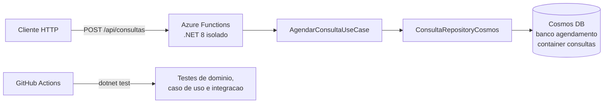

@'
# Agendamento de Consultas

API de agendamento de consultas construída com **C# (.NET 8)**, **Azure Functions** (modelo isolado) e **Azure Cosmos DB**. O projeto aplica regras de negócio em camadas, testes automatizados e infraestrutura como código.

## Arquitetura



O código segue uma separação em camadas:

| Projeto | Responsabilidade |
|---|---|
| `Agendamento.Domain` | Entidade `Consulta` e suas validações |
| `Agendamento.Application` | Caso de uso `AgendarConsultaUseCase` e contrato `IConsultaRepository` |
| `Agendamento.Infrastructure` | Implementação do repositório no Cosmos DB |
| `Agendamento.Functions` | Endpoint HTTP, exposto como Azure Function |
| `Agendamento.Tests` | Testes xUnit: domínio, caso de uso e integração |
| `infra/` | Infraestrutura em Bicep |

## Regras de negócio

- O paciente é obrigatório.
- A duração da consulta deve ser maior que zero.
- Não é permitido agendar horários sobrepostos. Consultas que começam logo após o fim de outra são aceitas.

## Endpoint

### `POST /api/consultas`

Corpo da requisição (aceita campos em maiúsculas ou minúsculas):

```json
{
  "paciente": "Maria",
  "inicio": "2026-11-10T09:00:00-03:00",
  "duracaoMinutos": 30
}
```

| Status | Situação |
|---|---|
| `201 Created` | Consulta criada e gravada no Cosmos DB |
| `409 Conflict` | Já existe consulta no horário solicitado |
| `400 Bad Request` | Dados inválidos (paciente vazio, duração zero ou corpo ausente) |

## Executando localmente

Pré-requisitos: .NET SDK 8, Azure Functions Core Tools 4, Azurite e Azure CLI.

1. Inicie o Azurite em uma janela separada:

   ```
   azurite --silent --location $HOME\AzuriteData
   ```

2. Defina as credenciais do Cosmos DB e suba a Function App:

   ```
   cd Agendamento.Functions
   $env:CosmosEndpoint = "https://<sua-conta>.documents.azure.com:443/"
   $env:CosmosKey = "<sua-chave>"
   func start
   ```

3. Teste o endpoint:

   ```
   Invoke-RestMethod -Method Post -Uri http://localhost:7071/api/consultas -ContentType "application/json" -Body '{"paciente":"Maria","inicio":"2026-11-10T09:00:00-03:00","duracaoMinutos":30}'
   ```

## Testes

```
dotnet test Agendamento.sln
```

Os testes de integração gravam e removem um item de teste no Cosmos DB. Eles são ignorados automaticamente quando as variáveis `CosmosEndpoint` e `CosmosKey` não estão definidas.

## Infraestrutura

O arquivo `infra/main.bicep` provisiona:

- Conta do Cosmos DB no tier gratuito, com banco `agendamento` e container `consultas` (chave de partição `/paciente`)
- Conta de armazenamento para a Function App
- Plano **Flex Consumption** (FC1) para Azure Functions em Linux
- Function App em .NET 8 isolado

Validar e implantar:

```
az bicep build --file infra/main.bicep --stdout
az deployment group create --resource-group rg-agendamento --template-file infra/main.bicep
```

## CI/CD

O workflow `.github/workflows/ci.yml` executa `dotnet test` a cada push na branch `master` e a cada pull request.

## Status

| Etapa | Situação |
|---|---|
| Domínio, caso de uso e API | Concluído |
| Persistência no Cosmos DB | Concluído |
| Testes de domínio e integração | Concluído |
| Infraestrutura em Bicep | Concluído (implantada) |
| Integração contínua (GitHub Actions) | Concluído |
| Publicação do código na Function App | Pendente |
'@ | Set-Content -Path $HOME\Documents\agendamento-azure\README.md -Encoding UTF8; cd $HOME\Documents\agendamento-azure; git add README.md; git commit -m "Documentacao: README com arquitetura e instrucoes"; git push; "README enviado"